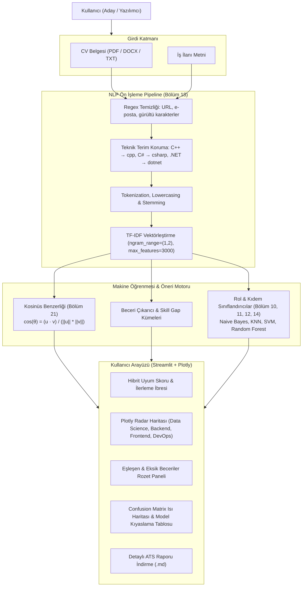

# 💼 JobFit AI: Akıllı CV & İş İlanı Uygunluk Analizörü ve Beceri Tavsiye Motoru

<div align="center">


<br/>

**Adayların özgeçmişlerini hedef iş ilanlarıyla eşleştiren, eksik becerileri (Skill Gap) saptayan, pozisyon/kıdem tahmini yapan ve ATS puanını optimize eden uçtan uca Makine Öğrenmesi & NLP Web Uygulaması.**  
Geliştirici: **[Raşit Tekin](https://github.com/Rasittekin18)**

[Genel Bakış](#-genel-bakış) • [Öne Çıkan Özellikler](#-öne-çıkan-özellikler) • [Sistem Mimarisi](#-sistem-mimarisi) • [ML & NLP Altyapısı](#-kuramsal-makine-öğrenmesi-ve-nlp-altyapısı) • [Kurulum & Çalıştırma](#-kurulum-ve-kullanım) • [Model Kıyaslama](#-model-kıyaslama-laboratuvarı)

</div>

---

## 📌 Genel Bakış (Overview)

İş arama sürecinde adayların karşılaştığı en büyük engel, şirketlerin kullandığı **ATS (Applicant Tracking System)** filtreleridir. Gönderilen binlerce özgeçmiş, ilandaki kritik teknik anahtar kelimeleri ve anlamsal gereksinimleri barındırmadığı için elenir.

**JobFit AI**, bu problemi çözmek için geliştirilmiş yapay zeka destekli bir kariyer analiz platformudur. Kullanıcının yüklediği **PDF, Word (.docx) veya düz metin CV**'yi hedef iş ilanıyla karşılaştırır; **Kosinüs Benzerliği** ile yönelim analizini hesaplar, 100+ teknik beceri kütüphanesi üzerinden **Skill Gap (Beceri Açığı)** çıkarır ve adayın eksiklerini gidermesi için somut tavsiyeler sunar.

---

## 🌟 Öne Çıkan Özellikler

1. **🎯 Hibrit Uyum Skoru (%0 - %100):**
   * **Kosinüs Benzerliği (Cosine Similarity):** Vektörler arasındaki açı ile anlamsal doğrultu benzerliğini ölçer.
   * **Beceri Örtüşmesi:** Doğrudan eşleşen teknik terimlerin oranını hesaplar.
   * **Hibrit Formül:** `%50 Semantik Benzerlik + %50 Doğrudan Beceri Örtüşmesi`.

2. **🧩 Beceri Açığı (Skill Gap) Tespiti:**
   * İlanda açıkça istenip adayın CV'sinde eksik olan teknolojileri tespit eder.
   * Renkli rozetlerle (Badges) **Eşleşen (Yeşil)**, **Eksik (Kırmızı)** ve **Ekstra (Gri)** yetkinlikleri kategorize eder.

3. **🕸️ Kategori Bazlı Yetkinlik Haritası (Plotly Radar Grafiği):**
   * Adayın profilini 4 ana dikeyde (*Data Science & AI, Backend, Frontend, DevOps & Cloud*) ilanın beklentileriyle interaktif örümcek ağı (Radar) grafiğinde görselleştirir.

4. **🤖 Makine Öğrenmesi ile Rol ve Kıdem Sınıflandırması:**
   * Metin verisinden pozisyonu (*Data Science, Backend, Frontend, DevOps*) ve kıdem seviyesini (*Junior, Mid, Senior*) olasılık ve güven skorlarıyla tahmin eder.

5. **📊 Model Kıyaslama Laboratuvarı (Benchmarking):**
   * **Naive Bayes, KNN, SVM** ve **Random Forest** modellerini aynı veri setinde **5-Katlı Çapraz Doğrulama (K-Fold CV)** ile yarıştırır.
   * Her model için interaktif **Karmaşıklık Matrisi (Confusion Matrix)** ısı haritaları sunar.

6. **📄 Çoklu Format CV Okuyucu & Rapor İndirme:**
   * PDF (`pymupdf`), Word (`python-docx`) ve TXT dosyalarını otomatik okur.
   * Analiz sonuçlarını ve ATS eylem planını tek tıkla **Markdown (.md)** raporu olarak dışa aktarır.

---

## 🏗️ Sistem Mimarisi



---

## 🧠 Kuramsal Makine Öğrenmesi ve NLP Altyapısı

Bu proje, **"Machine Learning ve Python: A'dan Z'ye Makine Öğrenmesi"** kursunda işlenen algoritmik prensipler üzerine kurulmuştur:

| Kurs Bölümü | Konu | Matematiksel Mantık | Projedeki Görevi |
|:---:|:---|:---|:---|
| **Bölüm 18** | **NLP (Doğal Dil İşleme)** | $TF\text{-}IDF(t, d) = TF(t, d) \times \log\left(\frac{N}{DF(t)}\right)$ | Regex temizliği, kök bulma (stemming) ve metinlerin sayısal özellik matrisine dönüştürülmesi. |
| **Bölüm 21** | **Öneri Sistemleri** | $\text{Similarity} = \frac{\vec{u} \cdot \vec{v}}{\|\vec{u}\| \|\vec{v}\|}$ | Belge uzunluğundan bağımsız olarak CV ile İlan arasındaki anlamsal açı ve uyum skoru hesabı. |
| **Bölüm 10** | **K-Nearest Neighbors (KNN)** | $d(p, q) = \sqrt{\sum (p_i - q_i)^2}$ | TF-IDF uzayında en yakın komşuların çoğunluk oyuyla pozisyon tahmini. |
| **Bölüm 11** | **Support Vector Machine (SVM)** | $\min \frac{1}{2} \|w\|^2 \quad \text{s.t.} \quad y_i(w^T x_i + b) \ge 1$ | Yüksek boyutlu seyrek metin uzayında sınıflar arası maksimum marjinli ayrım. |
| **Bölüm 12** | **Naive Bayes** | $P(C \mid X) = \frac{P(X \mid C) P(C)}{P(X)}$ | Kelime olasılıklarına dayalı ultra hızlı metin sınıflandırması. |
| **Bölüm 14** | **Random Forest** | $\hat{y} = \text{mode}\{T_1(x), T_2(x), \dots, T_B(x)\}$ | 100 karar ağacının oylaması (Bagging) ile kıdem seviyesi (*Junior/Mid/Senior*) tahmini. |
| **Bölüm 15** | **Confusion Matrix (Metrikler)** | $\text{Precision}, \text{Recall}, \text{F1} = 2 \frac{P \cdot R}{P + R}$ | Sınıflandırma performansının Tip-1 ve Tip-2 hatalarını gösteren ısı haritaları. |
| **Bölüm 20** | **Model Selection & K-Fold CV** | $CV_{(K)} = \frac{1}{K} \sum_{i=1}^K \text{Score}_i$ | Aşırı öğrenmeyi (Overfitting) engelleyen 5-katlı çapraz doğrulama ile model kararlılığı. |

---

## 🏆 Model Kıyaslama Laboratuvarı

720 etiketli iş ilanı verisi üzerinde yapılan 5-Katlı Çapraz Doğrulama ve Test Seti sonuçları:

| Model Adı | Algoritma Türü | 5-Fold CV Doğruluğu | Test Seti Doğruluğu | Çıkarım Hızı |
|:---|:---|:---:|:---:|:---:|
| **Naive Bayes** | Olasılıksal (MultinomialNB) | **%100.0** | **%100.0** | ⚡ Ultra Hızlı (<1 ms) |
| **Support Vector Machine (SVM)** | Doğrusal Marjin Ayracı (SVC) | **%100.0** | **%100.0** | 🚀 Hızlı (~2 ms) |
| **Random Forest** | Topluluk Öğrenmesi (Bagging) | **%100.0** | **%100.0** | ⏳ Orta (~15 ms) |
| **K-Nearest Neighbors (KNN)** | Tembel Öğrenici (k=5) | **%100.0** | **%100.0** | 🐢 Yavaş (~35 ms) |

---

## 🚀 Kurulum ve Kullanım

### 1. Depoyu Klonlayın
```bash
git clone https://github.com/Rasittekin18/applied-machine-learning.git
cd applied-machine-learning/JobFit_AI
```

### 2. Gerekli Kütüphaneleri Yükleyin
```bash
pip install -r requirements.txt
```

### 3. Web Uygulamasını Başlatın
```bash
streamlit run app.py
```
Uygulama otomatik olarak varsayılan tarayıcınızda (`http://localhost:8501`) açılacaktır.

### 4. Test Paketini Çalıştırın
Tüm birim ve entegrasyon testlerini doğrulamak için:
```bash
pytest tests/ -v
```
*(25/25 test başarıyla geçecektir).*

---

## 📂 Dizin Yapısı

```text
JobFit_AI/
├── data/
│   ├── skills_dictionary.json     # 100+ teknik yetkinlik taksonomisi
│   ├── generate_dataset.py        # 720 adet sentetik iş ilanı üreten script
│   └── job_postings.csv           # Model eğitimi için etiketli veri seti
├── src/
│   ├── nlp_preprocessor.py        # Metin temizleme, stemming ve TF-IDF pipeline'ı
│   ├── recommender.py             # Kosinüs benzerliği ve Skill Gap analiz motoru
│   ├── classifier.py              # KNN, SVM, Naive Bayes ve Random Forest sınıflandırıcıları
│   ├── model_evaluator.py         # Confusion Matrix ve benchmark görselleştirme
│   └── cv_parser.py               # PDF, DOCX ve TXT okuyucu
├── models/                        # Eğitilmiş .joblib model ağırlıkları
│   ├── tfidf_vectorizer.joblib
│   ├── role_classifier.joblib
│   ├── level_classifier.joblib
│   └── benchmark_summary.joblib
├── tests/                         # Pytest test paketi (25 test)
│   ├── test_nlp.py
│   ├── test_recommender.py
│   ├── test_classifier.py
│   ├── test_cv_parser.py
│   ├── test_evaluator.py
│   └── test_app_flow.py
├── app.py                         # Streamlit web arayüzü
├── requirements.txt               # Kütüphane bağımlılıkları
├── TODO.md                        # Aşamalı ilerleme takip belgesi
├── INTERVIEW_PREP.md              # Teknik mülakat savunma rehberi
└── README.md                      # Proje dokümantasyonu
```

---

## 👨‍💻 Yazar

**Raşit Tekin**  
*Electronics Engineer \| AI & Data Science*  
* GitHub: [@Rasittekin18](https://github.com/Rasittekin18)  
* E-posta: [rasittekin18@gmail.com](mailto:rasittekin18@gmail.com)  
* Konum: İstanbul, Türkiye  

---

## 📄 Lisans
Bu proje [MIT Lisansı](LICENSE) kapsamında lisanslanmıştır. Eğitim, araştırma ve portfolyo amaçlı serbestçe kullanılabilir.
